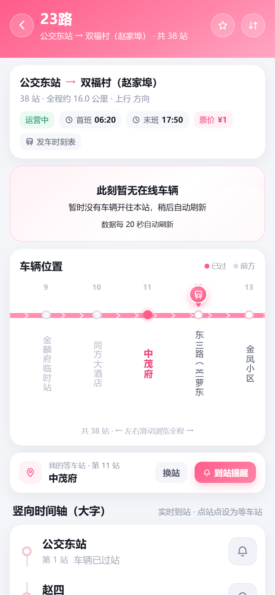
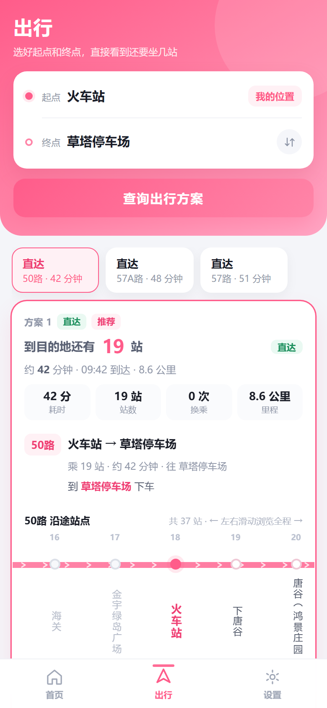
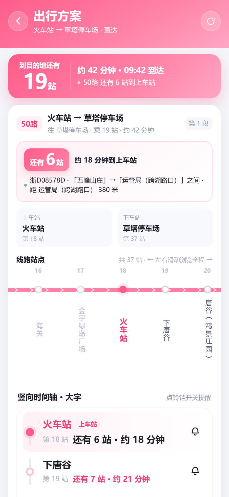
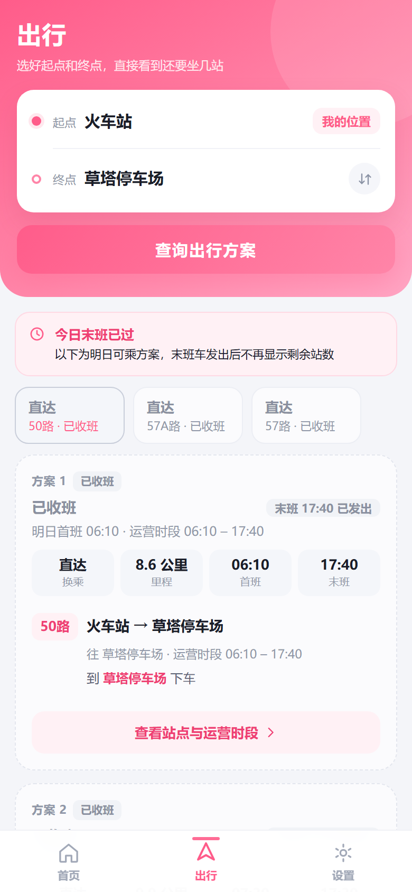
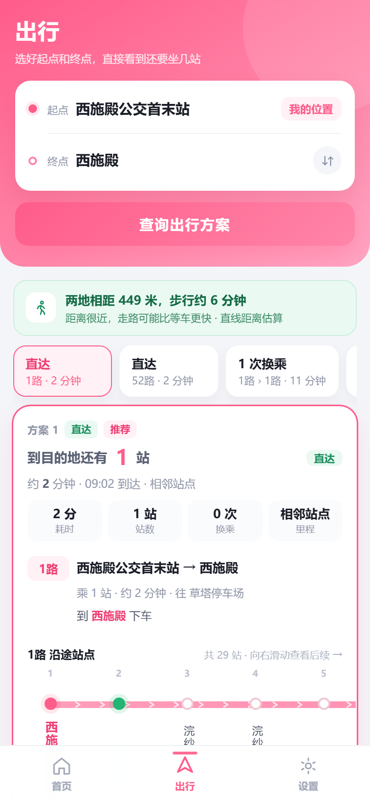
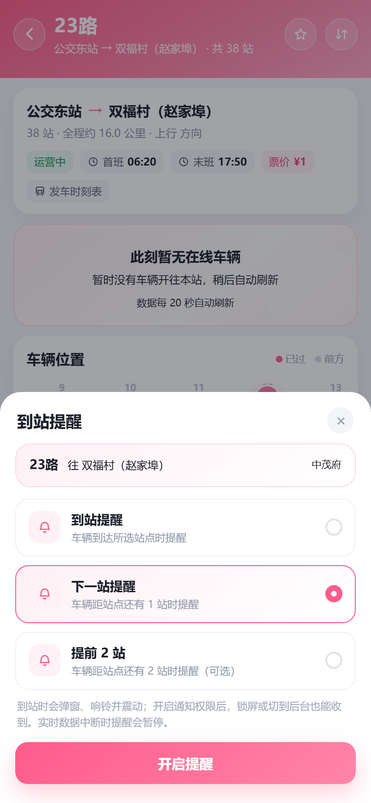
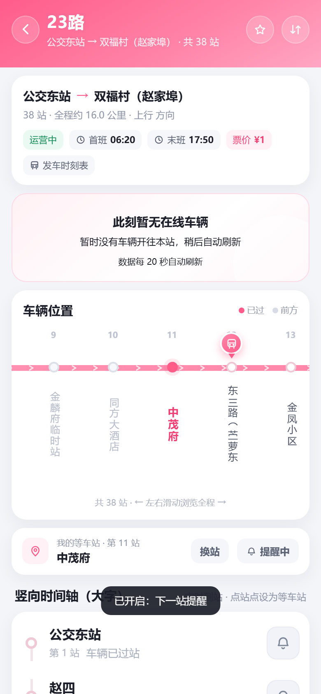

# 诸暨公交 · 长者易用版（v1.4.0）

> 基于 [`byazlle/zhuji-bus-live`](https://github.com/byazlle/zhuji-bus-live) **v2.0.0（APK 1.1.1）** 二次开发的精简版：去掉地图 SDK、公告与「我的」，只留 **首页 / 出行 / 设置** 三个标签。v1.4.0 在两件事上重点升级：**首末班时间校验**（收班后不再渲染剩余站数与预估到达时间）与**出行方案多元化**（多套方案卡片、可切换、收班过滤、近距步行提示）。

<p>


</p>

| 首页（精简） | 线路实时（横向时间轴） | 竖向时间轴 · 大字 |
|---|---|---|
|  |  |  |

| 出行结果（多套方案 · 还有几站） | 方案详情（大字 + 分段实时） | 竖向时间轴 · 大字站点 |
|---|---|---|
|  |  |  |

| 收班态（不再显示站数/到达时间） | 近距步行提示 | 设置页 |
|---|---|---|
|  |  |  |

| 主题切换（天空蓝） | 通知权限引导 | 选站弹层（大字） |
|---|---|---|
|  |  |  |

| 到站提醒设置 | 到站提醒（响铃 + 震动） | 首页提醒概览 |
|---|---|---|
|  |  |  |

---

## 在线体验与下载

| 类型 | 地址 |
|---|---|
| 网页版（手机浏览器打开） | **https://0124577.github.io/zhuji-bus-navi/** |
| 安卓安装包（APK 约 3.0 MB） | **[zhuji-bus-navi-v1.4.0.apk](https://github.com/0124577/zhuji-bus-navi/releases/download/v1.4.0/zhuji-bus-navi-v1.4.0.apk)** |
| 版本发布说明 | https://github.com/0124577/zhuji-bus-navi/releases/tag/v1.4.0 |
| 源码仓库 | https://github.com/0124577/zhuji-bus-navi |
| 上一版（v1.3.0） | https://github.com/0124577/zhuji-bus-elder/releases/tag/v1.3.0 |

APK 为自签名（`CN=Zhuji Bus Live`），安装时需允许「安装未知来源应用」；包名 `com.zhuji.bus.lite`，版本名 `1.4.0`（versionCode 5），最低 Android 5.1。与 v1.1.0 / v1.2.0 / v1.3.0 **同一签名**，可直接覆盖升级，本地收藏与提醒不丢。

---

## 一、项目介绍

诸暨公交官方实时接口（`zjcx.zhuji.gov.cn`）免登录可用，但原版页面以「线路列表 + 站点序列」为主，缺少**车辆在路上的位置**、**一句话说清坐几站**和**下车提醒**。本项目在 v2.0.0 的静态站点表与换乘算法上重做前端，目标用户是**看手机不太方便的长辈**：

- **只做三件事**：看车（实时公交）、去哪（换乘方案）、设置（声音与提醒）
- **三个 Tab**：首页、出行、设置；没有公告、没有「我的」、没有地图
- **「还有几站」是主角**：出行结果卡片第一行、方案详情顶部大字条都写「到目的地还有 N 站」，没有在线车辆时也按静态里程给出数字
- **收班就说收班**：按首末班时间判定运营状态，收班后**不再显示剩余站数与预估到达时间**，改成「已收班 · 末班 17:50 已发出 · 明日首班 06:20」
- **多套方案可选**：同一次查询给出直达 + 换乘多套方案卡片，每套都有耗时 / 站数 / 换乘 / 里程四项指标，点一下即切换
- **能听见、能摸到**：到站提醒同时**响铃 + 震动 +（安卓）系统通知**，锁屏也能收到
- **字号与触控为长者放大**：站名 15.5–17px、行高 56px、按钮 ≥40px、选站弹层 15px / 50px
- **没有地图**：跨站距离用 Haversine 本地计算，车辆位置用时间轴表达
- **静态兜底**：站点、线路、首末班、里程全部内置；实时接口连续失败时**自动降级**并给出醒目提示与重试

APK 包名 `com.zhuji.bus.lite`，版本 `1.4.0`，最低 Android 5.1（API 22），目标 API 34。

---

## 二、功能清单

### 首页（精简）
- 线路号搜索：395 条线路实时过滤（输入 `23` 即命中 `23路`），支持清空与空结果提示
- 我的收藏：收藏线路（胶囊）/ 收藏站点（列表），点击直达；**没有收藏时整块隐藏**，不留空白
- 到站提醒概览：显示「还有 2 站 · 约 4 分」「已提醒 19:03」或「线路已收班 · 明早恢复」，可管理
- 全部线路：按号段排序，支持「加载更多」；行内星标一键收藏

### 线路实时页
- 渐变头：线路名、起终点、站数、收藏、换向
- 信息卡：**运营状态标签**（运营中 / 末班车已发出 / 已收班 / 首班未发）、首末班、票价、发车时刻表入口
- 数据卡：最近一辆车距**我的等车站**的剩余站数 / 预计分钟 / 剩余距离、车牌、车辆位置文案
- **首末班校验**：收班或首班前，数据卡只显示「已收班 · 末班 17:50 已发出 · 明日首班 06:20」，不再显示剩余站数
- **横向线路时间轴**：站序 + 竖排站名 + 车辆图标按 GPS 落点，左右滑动浏览全程
- **竖向时间轴（大字版）**：15.5px 站名、56px 行高、连续轴线、`还有 N 站 · 约 X 分钟`、40px 提醒铃铛；收班时这一列改显示「已收班」
- 上下行切换、20 秒自动刷新、失败重试；发车时刻表高亮未发班次

### 出行（v1.4.0 重点：方案多元化）
- 起点 / 终点：线路展开选站 + 站名搜索两种方式；起点可用「我的位置」按直线距离挑附近站
- 查询即规划：**直达方案优先**，并在直达较少时自动附带 1 次 / 2 次换乘备选，同屏最多 6 套
- **多套方案卡片**：每套一张卡，头部标 `方案 1 · 直达 · 推荐`，卡内四格核心指标（耗时 / 站数 / 换乘 / 里程）+ 大字「到目的地还有 N 站」
- **一键切换查看**：顶部方案标签与下方卡片都可点，选中卡片展开分段明细与沿途站点时间轴（复用详情页同一套组件）
- **收班过滤**：采集方案时按当前时刻过滤掉已收班 / 首班未发的方案；若全部收班，则整队保留并标注「明日参考」，顶部提示「今日末班已过」
- **近距步行提示**：起终点直线距离 ≤ 1.2 公里时，结果区顶部给一张绿色步行卡（「两地相距 449 米，步行约 6 分钟」），公交方案照常可选
- 最近查询：最多 20 条，单条删除 / 一键清空 / 点击重查
- 边界：起终点选成同一个站会被直接拦下；页面不会残留与当前起终点不符的旧方案

### 方案详情（大字 + 分段实时 + 到站提醒）
- **顶部大字条**：「到目的地还有 N 站」（35px）永远显示；右侧「约 X 分钟 · HH:MM 到达」+ 一行「50路 还有 3 站到上车站」或「暂无在线车辆 · 按静态里程估算」
- **收班态大字条**：改为「已收班」大字 + 「末班 17:40 已发出 · 明日首班 06:10」，**不出现剩余站数与到达时间**
- 每段卡片：线路徽标、往方向、**该段实时车辆块**（剩余站数 / 约几分钟 / 车牌 / 位置）、乘车信息、横向站点条、**竖向大字时间轴**
- **站点级提醒**：每站可开 / 关到站提醒或下一站提醒（也可提前 2 站），写入本地并在首页提醒卡片同步
- 每段可直接跳到该线路实时页；接口异常时顶部出现「已自动降级」+ 重试，站序与提醒照常可用

### 设置
- **主题色**：玫瑰粉 / 天空蓝 / 松柏绿 / 暖橙，CSS 变量 + `data-theme` 即时生效，同步状态栏色
- **提示音**：开 / 关；**音量** 0–100（松手试听，WebAudio 合成三声上行铃声，无音频文件）
- **震动**：开 / 关（全局拦截 `navigator.vibrate`）
- **提醒轮询间隔**：10 / 15 / 20 / 30 秒，改后立即对提醒引擎与详情页轮询生效
- **通知权限**：状态徽标（已开启 / 未开启 / 已关闭 / 不支持）+ 说明 + 一键申请 + 「去系统设置」；开启提醒时若无权限会弹窗引导
- **清除缓存**：二次确认，只清查询记录与临时状态，不动收藏 / 提醒 / 设置
- **关于**：版本、包名、线路与站点数量、数据来源、许可

### 到站提醒（本地 + 系统通知）
- 三种粒度：到站（剩 0 站）、下一站（剩 1 站）、提前 2 站
- 触发：应用内弹窗 + **响铃** + **震动**；开通知权限后额外发**系统通知**（锁屏 / 后台可见，点击回 App）
- **收班保护**：判定为收班后提醒进入「线路已收班」状态，不再请求接口，也不会用过期数据误触发
- 依赖实时接口：接口中断时提醒暂停，不会误报；最多同时 10 条，可删除或清空

### 明确不做
乘车码 · 云端推送订阅 · 意见反馈 · 登录注册 · 地图渲染 · 地图 SDK 路径规划 · 公告 Tab · 我的 Tab · 车辆实时地图打点

---

## 三、首末班时间校验（v1.4.0 修复）

统一由 `ZJ.Service`（`www/js/core.js`）判定，**任何一次渲染 / 刷新都重新按当前时间计算，不缓存**：

| 状态 | 判定 | 界面表现 |
|---|---|---|
| `running` | 首班已发、末班未到本站 | 正常显示剩余站数与到达时间 |
| `lastGone` | 末班已从起点发出，但还没驶过本站 | 照常显示剩余站数，并标注「末班车已发出」 |
| `closed` | 当前时间已过「末班 + 起点到本站行驶时间」 | 只显示「已收班 · 末班时间 · 明日首班」，**无剩余站数、无到达时间** |
| `before` | 早于首班 15 分钟以上 | 只显示「首班未发 · 今日首班时间」 |
| `unknown` | 该方向缺首末班数据 | 按旧逻辑处理，不拦截 |

- **为什么不用「末班时间」一刀切**：末班车从起点站发出后仍会沿途载客，若在终点侧站点一到 17:50 就报收班，会把还能坐的车挡在外面。因此以「末班车到达**你的上车站**的时刻」为准，多出的部分用静态站距与平均车速推算（与后续到站估算同一口径）。
- **生效位置**：出行方案卡（含收班过滤与排序）、方案详情大字条 / 分段实时块 / 竖向时间轴、线路页数据卡与运营状态标签、站点页每条线路、到站提醒引擎、首页提醒卡片。
- **随时间自动切换**：详情页 20 秒轮询、提醒引擎按设定间隔、出行页每 30 秒比对一次状态；跨过末班时间会**自动**把界面切成收班态，无需重新查询。

---

## 四、技术栈

| 层 | 方案 |
|---|---|
| 前端 | 原生 HTML / CSS / ES6，无框架、无打包器，11 个 JS 模块 + 2 个 CSS |
| 数据 | 内置 `www/data/snapshot.js`（395 线路 / 3061 站点 / 22186 条站序），实时数据走官方接口 |
| 运营状态 | `ZJ.Service`（`info / isOpen / tag / note / resume`），按方向 + 上车站序判定 |
| 时钟 | `ZJ.Clock`（`nowMin / setFixed`），测试与截图可固定到指定分钟 |
| 主题 | CSS 变量（`--pink / --brand-rgb / --pink-t1..t4`）+ `:root[data-theme]` 四套配色 |
| 声音 | WebAudio `OscillatorNode` 合成（880 / 1046.5 / 1318.5 Hz） |
| 通知 | 自写 Capacitor 插件 `ZjNotifyPlugin`（check / request / notify / openSettings） |
| 本地存储 | `localStorage`（收藏 / 历史 / 提醒 / 偏好） |
| 定位 | `navigator.geolocation` + Haversine 距离，不接地图 SDK |
| 安卓壳 | Capacitor 6.2.1 + Gradle 8.2.1 + AGP 8.2.1，minSdk 22 / targetSdk 34 |
| 测试 | puppeteer-core + 本地 Chrome，390×844 视口，**245 项断言 / 18 组** |

### 目录结构

```
zhuji-bus-navi/
├─ www/                     # 纯静态站点（可直接部署）
│  ├─ index.html            # 三 Tab 骨架 + 全屏页（线路 / 方案 / 站点）+ 设置页
│  ├─ css/
│  │  ├─ app.css            # 变量化主题与基础样式
│  │  └─ theme.css          # 四套配色 + 多方案卡 / 收班态 / 步行提示 / 弹层放大
│  ├─ js/
│  │  ├─ core.js            # 工具、时钟、Service 首末班判定、数据索引、Prefs、Sound、Notify、时间轴
│  │  ├─ api.js             # 官方接口封装 + 实时数据加工（RT）+ 降级标记
│  │  ├─ reminder.js        # 到站提醒引擎（轮询、响铃、震动、系统通知、收班保护）
│  │  ├─ picker.js          # 选站弹层（线路展开 / 站名搜索）
│  │  ├─ line.js            # 线路实时页
│  │  ├─ station.js         # 站点实时页
│  │  ├─ plan.js            # 方案详情：大字「到目的地还有 N 站」+ 分段实时 + 收班态
│  │  ├─ go.js              # 出行：多方案规划 / 收班过滤 / 步行提示 / 历史
│  │  ├─ settings.js        # 设置页
│  │  ├─ home.js            # 首页
│  │  └─ app.js             # Tab 路由、定位、启动
│  └─ data/snapshot.js      # 静态数据快照（由脚本生成）
├─ android/                 # Capacitor 安卓工程（含 ZjNotifyPlugin）
├─ scripts/
│  ├─ extract-data.py       # 从 v2.0.0 基线提取静态数据
│  ├─ make_icons.py         # 生成图标与启动图
│  ├─ shot.mjs              # 界面截图（生成 16 张）
│  └─ verify-live.mjs       # 线上部署校验（32 项）
├─ tests/e2e/app-test.mjs   # 245 项 E2E 测试
├─ docs/自测报告.md
└─ README.md
```

---

## 五、快速开始（网页）

```bash
# 任意静态服务器即可，不能直接 file:// 打开（XHR 与模块加载）
python -m http.server 8899 --directory www
# 打开 http://127.0.0.1:8899
```

- `?mode=static`：强制静态模式（不请求实时接口，用于演示 / 离线）
- 默认 `api` 模式：实时接口失败时**自动**降级为静态站点数据
- 网页版没有原生插件，通知权限显示「不支持」，到站时仍会弹窗 + 响铃 + 震动；需锁屏通知请装 APK

---

## 六、数据说明

### 6.1 静态数据（兜底，随包内置）

`www/data/snapshot.js` 由 `scripts/extract-data.py` 从 v2.0.0 基线生成：

```js
window.SNAPSHOT = {
  v: 2,
  generated: "2026-11-18",
  names: ["西施殿公交首末站", "西施殿", ...],       // 站点名池，下标即站名 ID
  lines: [{
    n: "23路",
    d: [{
      k: "up", id: "3306812312",                    // 方向线路 ID（实时接口用）
      f: "06:20", l: "17:50",                       // 首末班（v1.4.0 运营状态判定的唯一依据）
      s: [[12, 480, 2971360, 12023620], ...]        // [站名ID, 到下一站米数, 纬度×1e5, 经度×1e5]
    }]
  }]
}
```

运行时索引会展开为：线路名 → 方向 → 有序站点（含累计里程 `cum`）、站点名 → 途经方向列表。换乘、耗时、附近站点、**运营时段**全部本地计算，不额外请求接口。

### 6.2 实时数据（官方接口）

基础地址 `https://zjcx.zhuji.gov.cn:9443`，POST JSON，固定请求头（见 `www/js/core.js` 的 `CFG.API_H`），`code === "200"` 为成功。

| 用途 | 路径 | 关键参数 | 主要返回 |
|---|---|---|---|
| 线路详情 | `/gzcx-busServer/client/busLine/queryLine` | `lineId` | `up.stationList`、`startFirst/startLast`、`totalPrice` |
| 实时车辆 | `/gzcx-busServer/client/bus/vehicle/dynamic/line/details` | `lineId` | `list[].vehicleOrder / distance / isArriveStation / plateNumber`、`busAverageSpeed` |
| 发车时刻表 | `/gzcx-busServer/client/busLine/getBusLinePlanSimpleTime` | `lineId` | `["06:20", ...]` |

**关键口径**：

- `vehicleOrder` = 车**已经驶离**的那一站（1 基），不是「下一站」
- 到某站的剩余站数 = `目标站序号 − vehicleOrder`；为 0 且 `isArriveStation !== 1` 视为刚离站
- 预计分钟 = `剩余米数 / busAverageSpeed + 剩余站数 × 0.35`（停靠折算）
- 「到目的地还有 N 站」= 各乘车段站数之和（换乘方案会累计）
- 收班判定 = `当前时间 > 末班时间 + rideMinutes(起点→上车站)`（缺首末班数据时不判定）

替换后端只需实现 `ZJ.Api.lineDetail / vehicles / plan`（`www/js/api.js`）。

---

## 七、网页部署

已部署：**https://0124577.github.io/zhuji-bus-navi/**（`gh-pages` 分支根目录 = `www/` 内容）

```bash
# 首次：把 www/ 推成 gh-pages 分支
git subtree push --prefix www origin gh-pages
# 之后每次改动 www/ 再执行同一条命令即可增量更新
```

也可在 **Settings → Pages** 手动选择分支 `gh-pages` / 根目录；或把 `www/` 整个目录丢到任意静态托管（Nginx / OSS / Vercel / Netlify）。

---

## 八、安卓打包教程

### 8.1 环境

| 依赖 | 版本 |
|---|---|
| JDK | 17（`JAVA_HOME`） |
| Android SDK | Platform 34 + Build-Tools 34.0.0 |
| Gradle | 8.2.1（AGP 8.2.1） |
| Node.js | 18+（仅 Capacitor CLI） |

### 8.2 步骤

```bash
npm install
npx cap sync android            # 把 www/ 同步到 android/app/src/main/assets/public
```

`android/local.properties`：

```properties
sdk.dir=/path/to/Android/Sdk
```

签名（`android/app/build.gradle` 已配置 `release`）：

```groovy
signingConfigs {
    release {
        storeFile file("../release.keystore")
        storePassword "******"
        keyAlias "zjbus"
        keyPassword "******"
    }
}
```

```bash
cd android && ./gradlew assembleRelease
# 产物：android/app/build/outputs/apk/release/app-release.apk
```

首次打包请生成自己的 keystore：

```bash
keytool -genkeypair -v -keystore release.keystore -alias zjbus \
  -keyalg RSA -keysize 2048 -validity 10950
```

### 8.3 安卓侧改动

- `AndroidManifest.xml`：`INTERNET`、`ACCESS_FINE_LOCATION`、`ACCESS_COARSE_LOCATION`、`VIBRATE`、**`POST_NOTIFICATIONS`**
- `MainActivity.java`：`onCreate` 第一行 `registerPlugin(ZjNotifyPlugin.class)`（必须在 `super.onCreate` 之前），随后申请定位权限、开启 WebView 的 `Geolocation / DOM Storage`
- **`ZjNotifyPlugin.java`**：`check()` 返回 `{granted, enabled, canAsk}`；`request()` 走 Android 13+ 运行时权限；`notify()` 建通道发 `NotificationCompat`（`BigTextStyle`），点击打开 App，无权限时返回 `{shown:false, reason:'no-permission'}`；`openSettings()` 跳系统通知设置
- 主题：状态栏 `#FF5C8A`、浅色导航栏；启动图为粉色渐变 + 巴士标志
- 包名 `com.zhuji.bus.lite`，`versionCode 5` / `versionName 1.4.0`

---

## 九、测试

```bash
python -m http.server 8899 --directory www     # 终端 1
node tests/e2e/app-test.mjs                    # 终端 2（需本地 Chrome）
```

- 结果：**245 项断言全部通过**，控制台 0 个 JS 错误（18 个分组）
- 测试用 `ZJ.Clock.setFixed(9 * 60)` 固定到运营时段，避免夜间跑测试全被判为收班；收班相关断言再切到 23:30 / 05:00 验证
- 覆盖：静态数据、首页精简、Tab 三栏、定位、线路搜索、线路实时、竖屏横向站点条、竖向大字时间轴、上下行、收藏、时刻表、本地到站提醒、站点页、换乘规划与历史、多套方案卡片与切换、方案详情、**首末班校验（收班过滤 / 收班态 / 首班前 / 线路页 / 站点页）**、**近距步行提示**、设置页、系统通知、边界（定位失败 / 搜索无结果 / 网络异常降级 / 无直达 / 起终点相同）、移动端适配、禁用功能核查
- 详见 [docs/自测报告.md](docs/自测报告.md)

线上校验（真实域名跑关键路径）：

```bash
node scripts/verify-live.mjs https://0124577.github.io/zhuji-bus-navi/
# 32 项：标题、静态数据、三个 Tab、出行多套方案（卡片 / 四项指标 / 时间轴 / 剩余站数）、
#       首末班判定与收班态、线路页收班、设置页、部署产物版本校验、0 报错 0 失败请求
```

---

## 十、已知限制

1. 实时接口由诸暨公交官方提供，**收班后多数线路无在线车辆**；此时界面按首末班显示「已收班」，不再给剩余站数与到达时间。
2. 收班判定以「末班车到达你的上车站」为准：末班车已从起点发出但尚未驶过本站时，仍会显示剩余站数并标注「末班车已发出」（这是还能坐到的车，不是假数据）。
3. 到站提醒依赖接口轮询：网页版前台可用（弹窗 + 响铃 + 震动）；**锁屏 / 后台的系统通知仅在 APK 且授予通知权限时可用**。
4. 无地图 SDK，换乘耗时、站间距离与步行提示均为**直线距离 / 静态里程**估算，不含步行路径与实时路况。
5. 静态快照为 2026-11 的站点表，官方调整线路后需重新执行 `python scripts/extract-data.py`；**首末班也来自该快照**，线路改点时需同步更新。
6. 发车时刻表部分线路官方返回空数组，此时仅展示首末班。
7. 主题色只改变品牌色与浅色底（含状态栏），未适配系统深色模式，以保证大字与高对比优先。

---

## 十一、致谢与免责

- 数据与站点表来源：[`byazlle/zhuji-bus-live`](https://github.com/byazlle/zhuji-bus-live)（v2.0.0 基线）
- 接口信息参考：[`fgh1995/zhujibus`](https://github.com/fgh1995/zhujibus)
- 本项目仅用于个人出行辅助，所有到站时间与换乘方案**仅供参考**，请以实际运营为准；请勿用于商业用途或高频抓取。

MIT License
