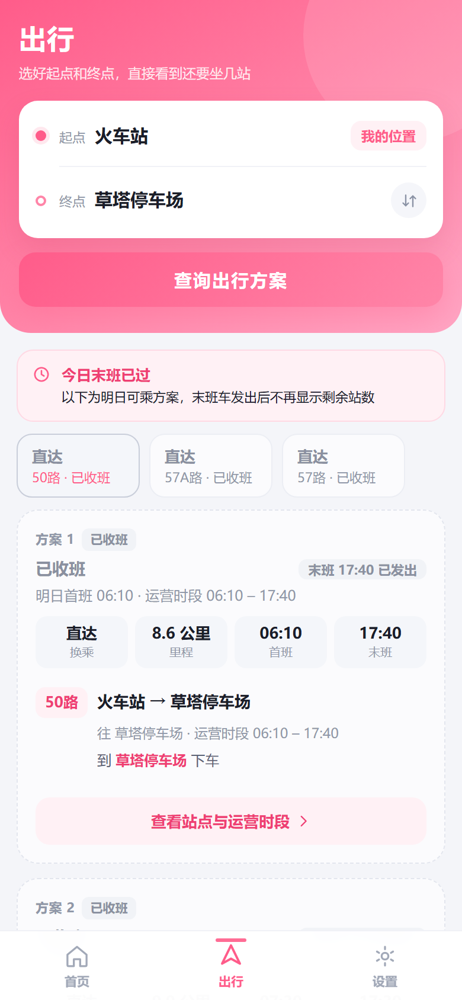
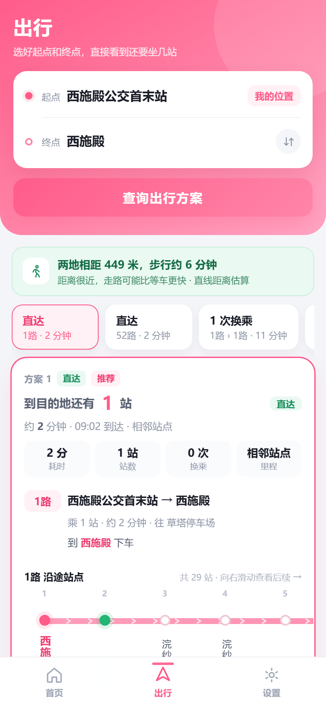

## 诸暨公交 · 长者易用版 v1.4.0

这一版做了两件事：**收班后不再骗人**，**出行给出多套方案**。

### 1. Bug 修复：首末班时间校验

以前夜里打开 App，即使线路 17:50 就收班了，页面仍可能显示「还有 6 站 · 约 18 分钟」「00:17 到达」。现在统一按首末班判定运营状态：

| 状态 | 界面 |
|---|---|
| 运营中 | 剩余站数 + 到达时间（与原来一致） |
| 末班车已发出、还没驶过你这一站 | 照常显示，另加「末班车已发出」标签 |
| **已收班** | 「已收班 · 末班 17:50 已发出 · 明日首班 06:20」，**没有站数、没有到达时间** |
| **首班未发** | 「首班未发 · 今日首班 06:20」，同样没有站数与到达时间 |

- 判定口径不是「末班发车时间」一刀切，而是**末班车到达你上车站的时刻**——末班车出站后还会沿途载客，不能一到点就把车窗外的车说成收班。
- **每次刷新都会重新判**：详情页 20 秒轮询、提醒引擎按设置间隔、出行页每 30 秒比对；跨过末班时间会自动切换，不用重新查询。
- 生效位置：出行方案卡、方案详情大字条 / 分段实时 / 竖向时间轴、线路页数据卡与状态标签、站点页每条线路、到站提醒与首页提醒卡片。
- 收班时详情页不再请求实时接口，只做重绘，省流量也避免拿过期车辆编数字。

### 2. 出行方案多元化

- **多套方案卡片**：一次查询最多 6 套，直达优先；每张卡都有 `方案 N · 直达 / 换乘 · 推荐` 头部与四格核心指标（耗时 / 站数 / 换乘 / 里程）
- **切换查看**：顶部标签或卡片本体都能点，选中卡展开分段明细 + 沿途站点横向时间轴（与详情页同一套组件）
- **收班过滤**：采集时就把已收班 / 首班未发的方案过滤掉；若全部收班，则整队标为「明日参考」并提示「今日末班已过」
- **近距离步行提示**：起终点直线距离 ≤ 1.2 公里时，结果区顶部给一张绿色步行卡（如「两地相距 449 米，步行约 6 分钟」），公交方案照常可选
- 相邻站点缺少官方站距时显示「相邻站点」，不再出现「0 米」

### 3. 其它

- 版本 `1.4.0`（versionCode 5），与旧版**同一签名**，可直接覆盖升级，收藏与提醒不丢
- 测试：E2E **245 项 / 18 组**全通过，0 控制台错误；线上部署校验 **32 项**全通过
- 文档：README 增加「首末班时间校验」章节（判定口径与生效范围）、数据说明补充首末班来源、新增 2 张截图（收班态 / 步行提示）

### 页面速览

| 收班态 | 近距步行提示 |
|---|---|
|  |  |

**网页版**：https://0124577.github.io/zhuji-bus-navi/
**APK**：见下方资产 `zhuji-bus-navi-v1.4.0.apk`（约 3.0 MB，Android 5.1+）
